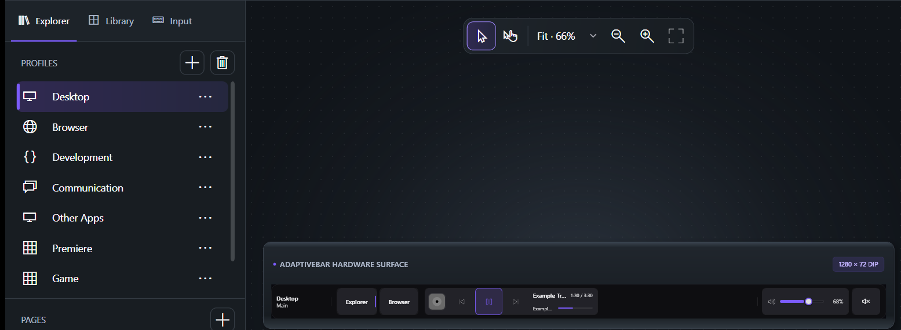

# ⚡ AdaptiveBarPC

**A contextual, non-activating Touch Bar control surface and visual studio for Windows secondary touchscreens.**

[**Explore the Docs**](docs/ARCHITECTURE.md) · [**Download Latest ZIP**](https://github.com/nguyentung12300/AdaptiveBarPC/releases) · [**Report Bug**](https://github.com/nguyentung12300/AdaptiveBarPC/issues) · [**Request Feature**](https://github.com/nguyentung12300/AdaptiveBarPC/issues)

 

---

## ✨ Why AdaptiveBarPC?

Most secondary screen dashboards on Windows are passive sensor panels, while traditional macro decks require a network client or steal window focus when touched. **AdaptiveBarPC** turns any secondary touchscreen strip into a native, context-aware control bar.

| Feature | What It Does |
| :--- | :--- |
| 🎯 **Never Steals Focus** | Built on Win32 `WS_EX_NOACTIVATE` and custom mouse-activation filtering so taps, sliders, and long-presses never interrupt your active game or creative app. |
| 🔄 **Context-Aware Switching** | Automatically switches profiles in real time based on the active foreground process or executable path. All layouts remain pure JSON. |
| 🎨 **AdaptiveBar Studio** | Includes a full visual drag-and-drop designer with live canvas preview, 100-step undo/redo, schema validation, and shareable `.adaptivebar-theme.zip` packages. |
| 🔊 **Smart Audio Routing** | Auto-detects **VoiceMeeter** buses when available and gracefully falls back to **Windows Core Audio**, per-app mixer sessions, or in-memory state on headless systems. |
| 🔒 **100% Local & Offline** | Zero telemetry or cloud accounts. Bundled 3D Fluent Emoji assets, hardware sensors, and profiles run entirely offline with instant startup. |

---

## 🧩 Built-in Widgets & Actions

AdaptiveBarPC ships with **15 widget types** and **13 action types** out of the box:

- **Audio & Media:** Master Volume slider, Per-App Audio Mixer, VoiceMeeter Bus/Strip controls, Media Playback (`GSMTC` with album art & seek bar).
- **System & Hardware:** Live CPU / GPU / RAM temperature & load gauges (`LibreHardwareMonitor`), Clock, Network status.
- **Productivity & Input:** Context-aware Emoji & Sticker picker, Clipboard history bar, Multi-page navigation, Pinned persistent controls.
- **Triggers:** Keyboard shortcuts (`SendInput`), App launcher, Text/Macro injection, Long-press secondary actions, and opt-in Shell commands.

---

## 🚀 Quick Start

### Option 1: Download Prebuilt Release (Recommended)

1. Download `AdaptiveBarPC-v0.2.4-win-x64.zip` from the [**Releases**](https://github.com/nguyentung12300/AdaptiveBarPC/releases) page.
2. Extract the archive. Run `AdaptiveBarPC.exe` from the `AdaptiveBarPC/` folder for the touch bar, or `AdaptiveBarPC.Designer.exe` from `AdaptiveBarPC-Studio/` to open **AdaptiveBar Studio**.

### Option 2: Build from Source

**Requirements:** Windows 10 or 11, [.NET 8 SDK](https://dotnet.microsoft.com/download/dotnet/8.0), and a secondary touchscreen monitor for the full experience.

~~~powershell
git clone https://github.com/nguyentung12300/AdaptiveBarPC.git
cd AdaptiveBarPC
dotnet restore AdaptiveBarPC.sln

# Run the Touch Bar Surface
dotnet run --project src/AdaptiveBarPC.App/AdaptiveBarPC.App.csproj

# Run AdaptiveBar Studio (Visual Designer)
dotnet run --project src/AdaptiveBarPC.Designer/AdaptiveBarPC.Designer.csproj
~~~

---

## 🛠️ Customizing Profiles

Create profiles visually using **AdaptiveBar Studio**, or edit JSON files directly in `src/AdaptiveBarPC.App/Profiles`.

<b>📄 View Minimal JSON Profile Example (Click to expand)</b>

~~~json
{
  "id": "my-browser",
  "displayName": "My Browser",
  "priority": 50,
  "match": {
    "processNames": ["msedge"]
  },
  "pages": [
    {
      "id": "main",
      "displayName": "Main",
      "items": [
        {
          "id": "refresh",
          "type": "button",
          "label": "Refresh",
          "action": {
            "type": "key",
            "value": "CTRL+R"
          }
        }
      ]
    }
  ]
}
~~~

> 💡 Full schema details—including multi-page layouts, fixed items, animated GIF/MP4 backgrounds, and v0.1 compatibility—are documented in [**Profile Format & Examples**](docs/PROFILE_FORMAT.md).

---

## 📚 Documentation

| Document | Description |
| :--- | :--- |
| 🏛️ [**Architecture**](docs/ARCHITECTURE.md) | Layer separation, Win32 interop, and audio/sensor service lifecycles. |
| 📐 [**Profile Format**](docs/PROFILE_FORMAT.md) | Complete JSON schema reference, widget properties, and action triggers. |
| 🎨 [**Design System**](docs/DESIGN.md) | Visual tokens, typography, and layout specifications for AdaptiveBar Studio. |
| 🗺️ [**Roadmap**](docs/ROADMAP.md) | Completed milestones (v0.1 – v0.2) and upcoming community goals. |
| 🤝 [**Contributing**](CONTRIBUTING.md) | Build instructions, architectural invariants, and pull request guidelines. |
| 📜 [**Third-Party Notices**](THIRD-PARTY-NOTICES.md) | Attribution and licenses for bundled dependencies and assets. |

---

## 📄 License

Distributed under the [**MIT License**](LICENSE). Copyright © 2026 **Nguyen Quang Tung**.

See [**THIRD-PARTY-NOTICES.md**](THIRD-PARTY-NOTICES.md) for license terms of bundled third-party assets and libraries.

---
