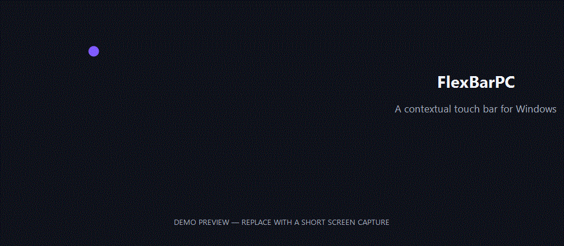

# AdaptiveBarPC

<!-- Replace this placeholder with a short product demo when one is ready. -->

AdaptiveBarPC is a contextual, non-activating control surface for a secondary touchscreen on Windows. It brings app-aware controls, media and audio tools, hardware sensors, and a visual profile designer into a slim horizontal bar.

## Why AdaptiveBarPC

- **Keeps focus where you are working.** The bar uses WS_EX_NOACTIVATE and handles mouse activation so taps and long presses do not activate AdaptiveBarPC or interrupt the foreground app.
- **Adapts to the foreground app.** Profiles switch automatically based on the active process or executable path. Layouts stay in JSON rather than process-specific UI code.
- **13 action types and 15 widget types.** Build controls for keyboard shortcuts, media, master volume, app launch, text and clipboard actions, per-app audio sessions, VoiceMeeter, CPU/GPU sensors, emoji, stickers, and more.
- **Includes AdaptiveBar Studio.** Create and edit profiles with a visual drag-and-drop designer, preview, validation, undo/redo, appearance controls, and shareable .adaptivebar-theme.zip themes.
- **Works offline.** Profiles and bundled emoji assets are local. Startup and core controls do not depend on a network connection.

## Quick start

Requirements: Windows 10 or 11, .NET 8 SDK, and a touchscreen monitor for the full experience.

~~~powershell
git clone https://github.com/YOUR_GITHUB_USERNAME/AdaptiveBarPC.git
cd AdaptiveBarPC
dotnet restore AdaptiveBarPC.sln
dotnet run --project src/AdaptiveBarPC.App/AdaptiveBarPC.App.csproj
~~~

To open the profile designer:

~~~powershell
dotnet run --project src/AdaptiveBarPC.Designer/AdaptiveBarPC.Designer.csproj
~~~

Published win-x64 and win-arm64 ZIPs will be attached to tagged GitHub Releases after the repository is set up.

## Create a profile

Copy an example from src/AdaptiveBarPC.App/Profiles, edit its match and pages, then run the app again. This minimal profile adds a browser refresh button:

~~~json
{
  "id": "my-browser",
  "displayName": "My Browser",
  "priority": 50,
  "match": {
    "processNames": ["msedge"]
  },
  "pages": [
    {
      "id": "main",
      "displayName": "Main",
      "items": [
        {
          "id": "refresh",
          "type": "button",
          "label": "Refresh",
          "action": {
            "type": "key",
            "value": "CTRL+R"
          }
        }
      ]
    }
  ]
}
~~~

Profiles support multiple pages, fixed controls, appearance, app matching, and 15 widget types. The v0.1 top-level items format remains supported.

## Documentation

- [Architecture](docs/ARCHITECTURE.md)
- [Profile format and examples](docs/PROFILE_FORMAT.md)
- [Designer visual system](docs/DESIGN.md)
- [Roadmap](docs/ROADMAP.md)
- [Contributing](CONTRIBUTING.md)
- [Third-party notices and asset licenses](THIRD-PARTY-NOTICES.md)

## Licensing

AdaptiveBarPC source code is available under the MIT License. Some bundled assets and dependencies have separate license terms; see THIRD-PARTY-NOTICES.md and the notices distributed with those assets.
